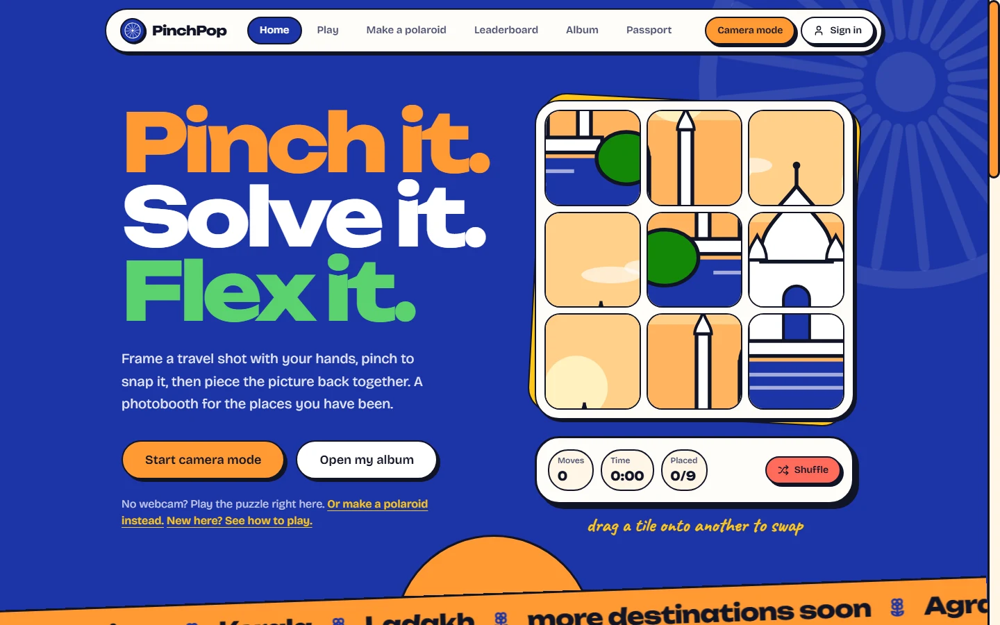
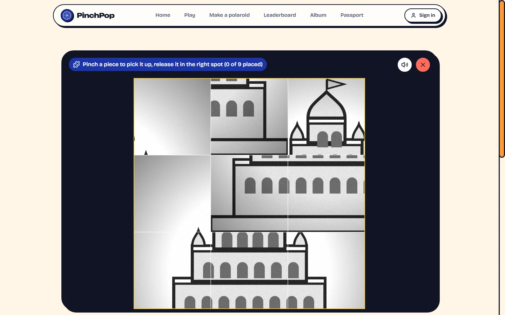
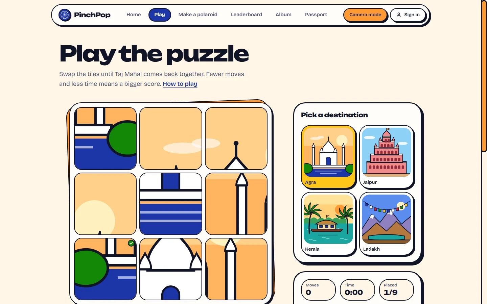
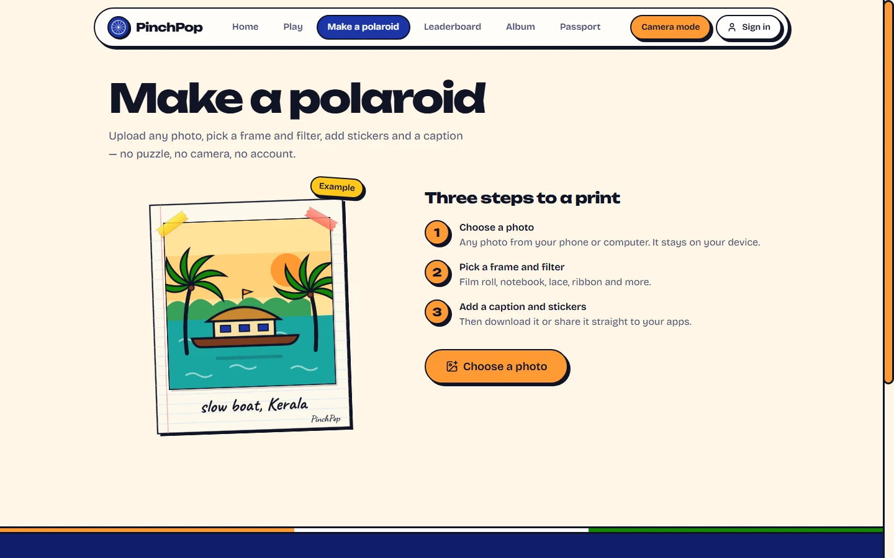
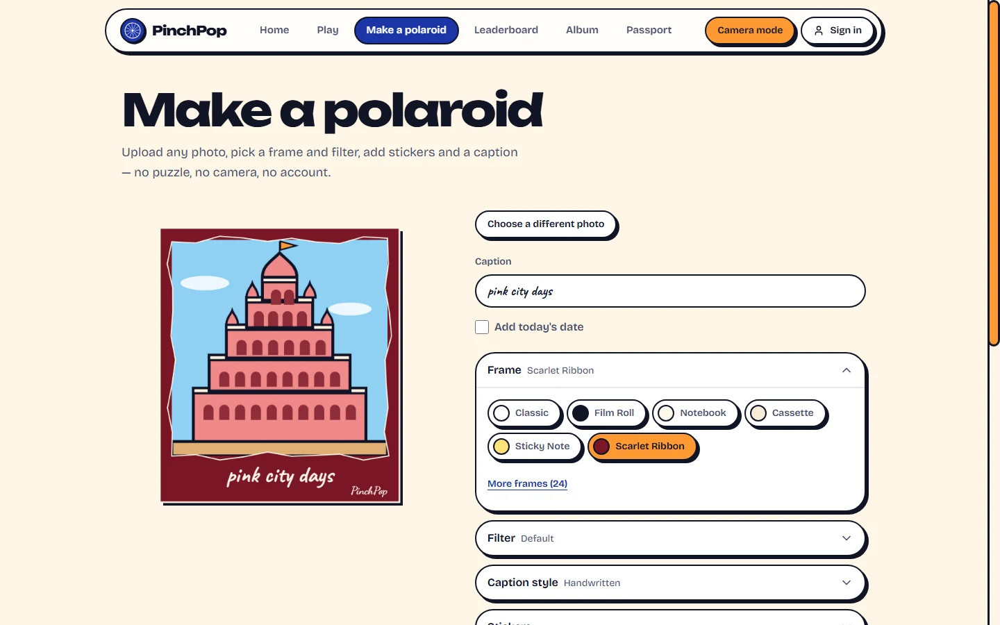
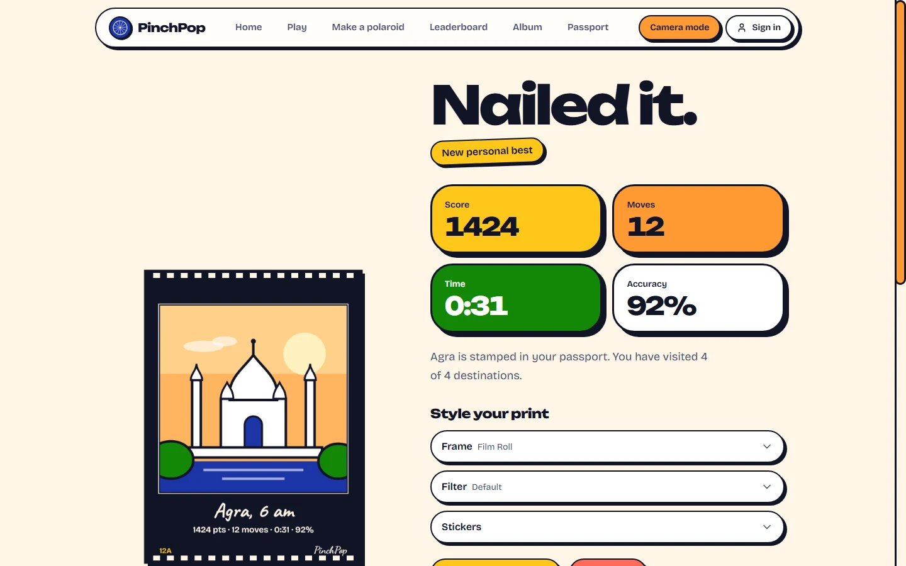
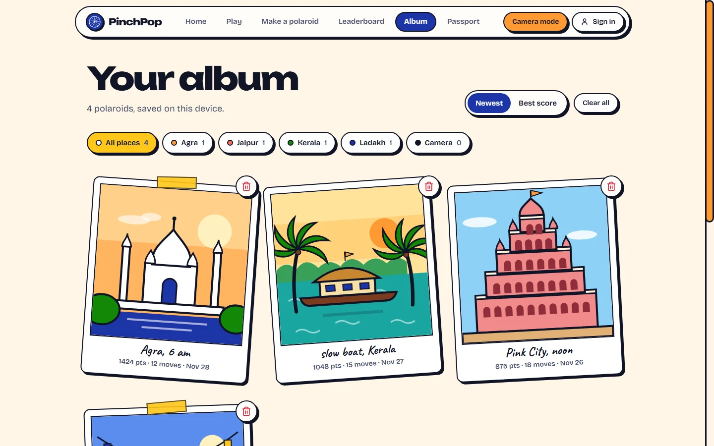
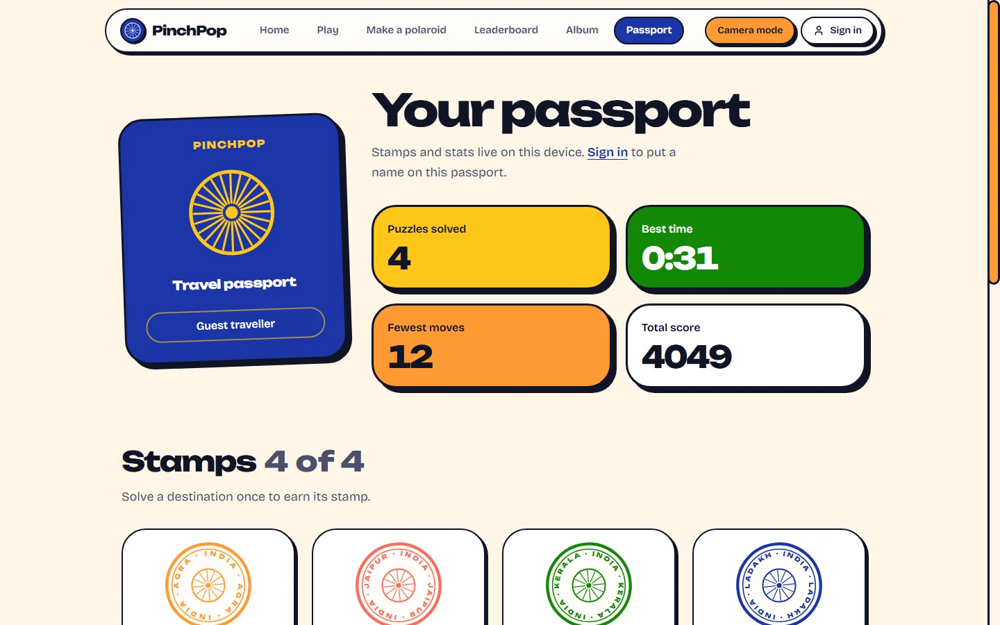
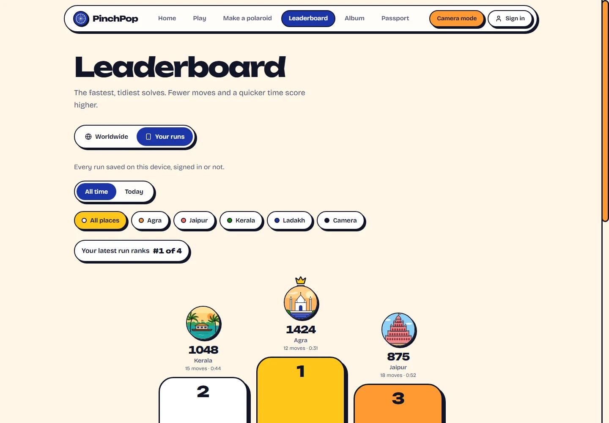
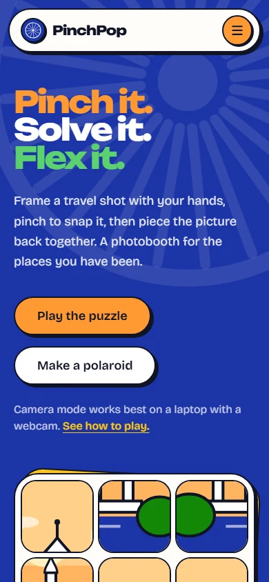

# PinchPop

**Capture. Solve. Remember.**

PinchPop is a photobooth you control with your hands. Frame a shot with your two index fingers on your webcam, pinch to snap it, then solve the photo as a 3×3 puzzle by pinching pieces to swap them. When you finish, you get a polaroid you can decorate, download and share.

No webcam? You can play the same puzzle with a mouse, a finger or a keyboard, or skip the game and turn any photo into a polaroid.

**Live app: [pinchpop.pages.dev](https://pinchpop.pages.dev)** — free, no account needed to play.



---

## Features

### Camera mode

Hand tracking runs entirely in your browser with MediaPipe, so your video never leaves your device.

| Gesture | What it does |
| --- | --- |
| Raise both hands | Starts tracking |
| Spread your index fingers | Frames the shot |
| Pinch with both hands and hold | Locks the frame and starts a 3-second countdown |
| Point at a piece and pinch, or hold still for a second | Selects it (it lights up); do it again to cancel |
| Pinch a second piece | Swaps the two; a piece in its right spot turns green and locks |
| Hold a fist | Saves the solved polaroid, or starts over mid-puzzle |

You can also upload a photo instead of using the webcam. Each camera run is recorded, from framing the shot to the solve, with the game's sounds, and can be downloaded from the results page as an MP4 (WebM in browsers that can't record MP4). It's kept only until you close the tab.



### Play the puzzle

Four illustrated Indian destinations (Agra, Jaipur, Kerala, Ladakh) to solve with a mouse, touch or keyboard. A tick marks every tile already in the right place, and **Peek** shows the finished picture.



### Make a polaroid

Turn any photo into a print, no puzzle or account needed.

- 30 frames, from a plain classic to designed cards: film roll, notebook, cassette, sticky note, torn note, lace, pink ribbon, pressed flowers and more. Six favourites show first.
- 12 photo filters
- 26 stickers you can drag, resize and remove, plus custom text labels
- Captions with a choice of font, size, colour and a tape background
- An optional date stamp

What you see in the preview is exactly what you download.

| Before you pick a photo | Styling a print |
| --- | --- |
|  |  |

### Results

After each solve you see your score, moves, time and accuracy, and can style the print with the same frames, filters and stickers before downloading it or sending it through your phone's share sheet. Signed-in players can also turn on a public link for a camera photo.



### Album, Passport and Leaderboard

- **Album:** every polaroid you've saved, sortable by date or score and filterable by destination.
- **Passport:** a stamp for each destination you solve, your best stats, and six milestones with progress toward the ones still locked.
- **Leaderboard:** a **Worldwide** board of signed-in players' best runs, and a **Your runs** board for everything saved on this device, filterable by all time or today and by destination.

| Album | Passport |
| --- | --- |
|  |  |



### Accounts (optional)

Everything works without an account and is saved in your browser. Signing in adds:

- Your runs and camera photos synced across devices
- A place on the worldwide leaderboard
- A profile picture, bio and public player page
- Account deletion that removes every cloud run and photo

### On phones

The home page, puzzle, polaroid maker, album, passport and leaderboard all work on phones. Camera mode works best on a laptop with a webcam.



---

## How scoring works

Every run starts at 2,000 points. Each move takes off 40 points and each second takes off 8, with a floor of 100. Accuracy, the share of your moves that put a piece in its right spot, then scales the result between 50% and 100%.

For example, 7 moves in 20 seconds with no wasted moves scores 2000 − 280 − 160 = 1,560.

---

## Privacy

- Camera video is processed in the browser and is never recorded or uploaded.
- Without an account, everything stays in your browser's local storage.
- With an account, runs and photos go to a private Supabase project protected by Row Level Security. Photos are only visible to their owner unless you turn on a public link for that photo.
- Analytics are Cloudflare's cookieless Web Analytics. There are no ads, trackers or cookies.

Full details are on the [Privacy](https://pinchpop.pages.dev/privacy) and [Terms](https://pinchpop.pages.dev/terms) pages.

---

## Tech stack

| Area | Tools |
| --- | --- |
| Frontend | React 19, TypeScript, Vite, React Router |
| Styling | Tailwind CSS v4, shadcn/ui and Radix primitives, self-hosted fonts via Fontsource |
| Hand tracking | MediaPipe Tasks Vision (Hand Landmarker), running in the browser |
| Graphics | Canvas 2D for puzzles and print rendering, generated SVG for frames, patterns and stickers |
| Audio and video | Web Audio API for sound effects, MediaRecorder for run videos |
| Backend | Supabase: Auth, Postgres with Row Level Security, Storage |
| Testing and quality | Vitest, ESLint, Prettier, TypeScript |
| Hosting | Cloudflare Pages |

Sticker illustrations that aren't hand-drawn in code come from [openclipart.org](https://openclipart.org) (public domain, CC0); see [`src/assets/stickers/SOURCES.md`](src/assets/stickers/SOURCES.md).

---

## Project structure

```text
src/
├── pages/            One file per route (Home, Game, Camera, Polaroid maker, Results, ...)
├── components/       Shared UI: nav, footer, polaroid preview, pickers, sticker layer, ...
├── lib/
│   ├── camera/       Webcam, MediaPipe tracking, gesture detection and the camera game engine
│   ├── export.ts     Canvas rendering for every print design, strips and downloads
│   ├── frames.ts     Frame presets
│   ├── memories.ts   Local storage for saved runs
│   ├── cloudRuns.ts  Supabase sync, leaderboard and public share queries
│   └── ...           Scoring, stats, stickers, filters, auth, SEO
├── assets/stickers/  Public-domain sticker illustrations
└── router.tsx        Routes
supabase/migrations/  Database schema, policies and storage buckets
public/               Icons, manifest, robots.txt, sitemap and the SPA redirect rule
docs/screenshots/     Images used in this README
```

---

## Getting started

You need Node.js 22.12 or newer and a webcam for camera mode.

```bash
git clone https://github.com/devKiNGCRiC/PinchPop.git
cd PinchPop
npm install
cp .env.example .env.local   # then fill in the values below
npm run dev
```

Supabase settings are only needed for sign-in, cloud sync and the worldwide leaderboard. Without them the app still runs: you can play, and runs are saved in the browser, while the sign-in form explains that accounts aren't set up. A free Supabase project is enough; see [Supabase setup](#supabase-setup).

### Environment variables

| Variable | Purpose |
| --- | --- |
| `VITE_SITE_URL` | Public URL used for canonical links and social previews |
| `VITE_SUPABASE_URL` | Your Supabase project URL |
| `VITE_SUPABASE_PUBLISHABLE_KEY` | Your Supabase publishable key (safe to ship to the browser; access is enforced by Row Level Security) |

Never put the Supabase secret key or database password in a `VITE_` variable; anything with that prefix ends up in the browser.

### Scripts

| Command | What it does |
| --- | --- |
| `npm run dev` | Starts the dev server |
| `npm run build` | Type-checks and builds to `dist/` |
| `npm run preview` | Serves the production build locally |
| `npm test` | Runs the Vitest suite |
| `npm run lint` | Runs ESLint |
| `npm run typecheck` | Runs the TypeScript compiler without emitting |
| `npm run format` | Formats the code with Prettier |

### Supabase setup

1. Create a free Supabase project.
2. Run the SQL files in `supabase/migrations/` in filename order, in the SQL Editor or with the Supabase CLI. They create the `profiles` and `runs` tables, their policies, the account-deletion function, and the `photos` and `avatars` storage buckets.
3. Copy the project URL and publishable key into your `.env.local`.

---

## Deployment

The live site is deployed on Cloudflare Pages from this repository:

- Build command: `npm run build`
- Output directory: `dist`
- Environment variables: the three listed above
- `public/_redirects` sends every path to `index.html`, so client-side routes work on refresh.

If the build fails on Node version, set a `NODE_VERSION` environment variable of 22 or newer in the Pages project.

---

## Browser support

| Browser | Support |
| --- | --- |
| Chrome, Edge | Recommended |
| Firefox | Supported |
| Safari | Limited |
| Mobile browsers | Everything except camera mode works well |

---

## Roadmap

- [x] Gesture capture and puzzle (camera mode)
- [x] Mouse, touch and keyboard puzzle
- [x] Accounts, cloud sync and public share links
- [x] Worldwide leaderboard, passport and milestones
- [x] Polaroid maker with designed frames, filters and stickers
- [ ] Photo strips
- [ ] Multi-photo frames
- [ ] More destinations and a reason to come back each day
- [ ] Android app

---

## License

No license has been chosen yet, so all rights are reserved for now.

---

## Author

Built by **Raj Roy**.

- GitHub: [@devKiNGCRiC](https://github.com/devKiNGCRiC)
- Instagram: [@devkingcric](https://www.instagram.com/devkingcric/)
- X: [@KiNGCRiC28](https://x.com/KiNGCRiC28)
